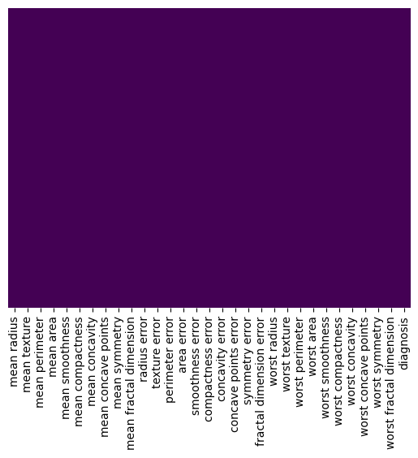

# 🩺 Breast Cancer Classification — Deep Learning (MLP)


## 📌 Project Overview
This project builds a **Deep Multi-Layer Perceptron (MLP)** binary classification model using **TensorFlow & Keras (Sequential API)** to classify breast cancer tumors as **Malignant (`0`)** or **Benign (`1`)** based on the **Breast Cancer Wisconsin (Diagnostic) Dataset**.

The pipeline includes exploratory data analysis (EDA), class distribution visualization, missing & duplicate value checks, feature standardization, stratified train/test splitting, neural network training with validation monitoring, and comprehensive evaluation using a Classification Report and Confusion Matrices.

---

## 📊 Dataset Description
The project uses the **Breast Cancer Wisconsin Dataset** (`sklearn.datasets.load_breast_cancer`):
- **Total Samples:** `569` instances
- **Number of Features:** `30` real-valued numerical features computed from digitized images of fine needle aspirate (FNA) of a breast mass (including `mean`, `error`, and `worst` values for radius, texture, perimeter, area, smoothness, compactness, concavity, concave points, symmetry, and fractal dimension).
- **Target Variable (`diagnosis`):**
  - **`1` (Benign):** `357` samples (`62.74%`)
  - **`0` (Malignant):** `212` samples (`37.26%`)

### Class Distribution
.png)

---

## 🛠️ Workflow & Preprocessing

### 1. Data Integrity Checks
- **Duplicate Rows:** Verified `0` duplicate rows across the dataset.
- **Missing Values:** Verified `0` null/missing values across all 30 features and target column.



### 2. Feature Scaling & Stratified Splitting
- **Standardization:** Scaled all 30 input features using `StandardScaler` (`mean = 0`, `std = 1`).
- **Train / Test Split:** Split dataset using stratified sampling (`stratify=Y`, `test_size=0.20`, `random_state=100`):
  - **Training Set:** `455` samples (`80%`, with `20%` of training used as validation during training)
  - **Testing Set:** `114` samples (`20%`)

---

## 🧠 Model Architecture (Sequential MLP)
Built a Feedforward Neural Network using the Keras `Sequential` API:

| Layer | Type | Units | Activation | Details |
| :--- | :--- | :---: | :---: | :--- |
| **Input / Hidden 1** | `Dense` | `32` | `ReLU` | `input_shape=(30,)` |
| **Hidden 2** | `Dense` | `16` | `ReLU` | Fully connected layer |
| **Output Layer** | `Dense` | `1` | `Sigmoid` | Binary probability output `[0, 1]` |

### Compilation & Training Setup
- **Loss Function:** `binary_crossentropy`
- **Optimizer:** `Adam`
- **Tracked Metrics:** `accuracy`, `precision`, `recall`
- **Training:** `100` Epochs | `Batch Size = 64` | `Validation Split = 0.2`

---

## 📈 Learning Curves & Evaluation Results

### Training vs. Validation Learning Curves
The model achieves high training and validation accuracy early in training with smooth loss convergence:

.png)

---

### Classification Report (Test Set)
On the unseen test set (`114` samples), the model achieved **98% overall accuracy**, with **100% recall on Benign (`1`)** and **100% precision on Malignant (`0`)**:

| Class | Precision | Recall | F1-Score | Support |
| :--- | :---: | :---: | :---: | :---: |
| **`0` (Malignant)** | `1.00` | `0.95` | `0.98` | `42` |
| **`1` (Benign)** | `0.97` | `1.00` | `0.99` | `72` |
| **Accuracy** | | | **`0.98`** | **`114`** |
| **Macro Avg** | `0.99` | `0.98` | `0.98` | `114` |
| **Weighted Avg** | `0.98` | `0.98` | `0.98` | `114` |


---

### Confusion Matrix (Raw Counts & Normalized)
Out of `114` test samples, the model correctly classified **`112` samples** (`40/42` Malignant and `72/72` Benign):

| Raw Confusion Matrix | Normalized Confusion Matrix |
| :---: | :---: |
| .png) | .png) |

---

## 🚀 How to Run

1. **Clone the repository:**
   ```bash
   git clone https://github.com/mahmoudmamsour46/Deep-Learning-Projects.git
   cd "Deep-Learning-Projects/Breast Cancer Classification"
   ```

2. **Install dependencies:**
   ```bash
   pip install -r requirements.txt
   ```

3. **Open the Jupyter Notebook:**
   ```bash
   jupyter notebook Breast_Cancer_Classification.ipynb
   ```

---

## 🧰 Technologies Used
- **Python 3**
- **TensorFlow / Keras** — Deep Neural Network (`Sequential`, `Dense`)
- **Scikit-Learn** — Dataset, `StandardScaler`, `train_test_split`, `classification_report`, `confusion_matrix`
- **Pandas & NumPy** — Data Manipulation & Numerical Computing
- **Matplotlib & Seaborn** — Data Visualization, Heatmaps & Learning Curves
