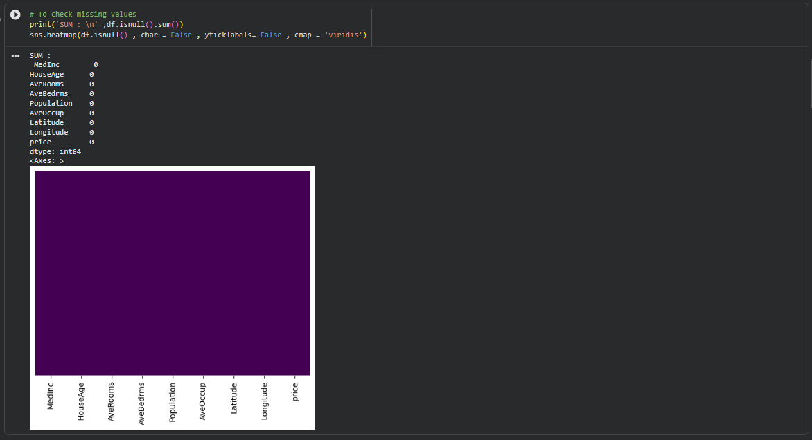
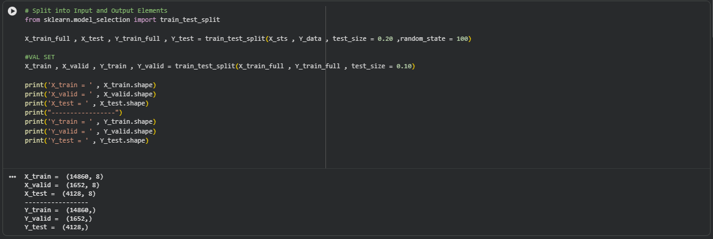
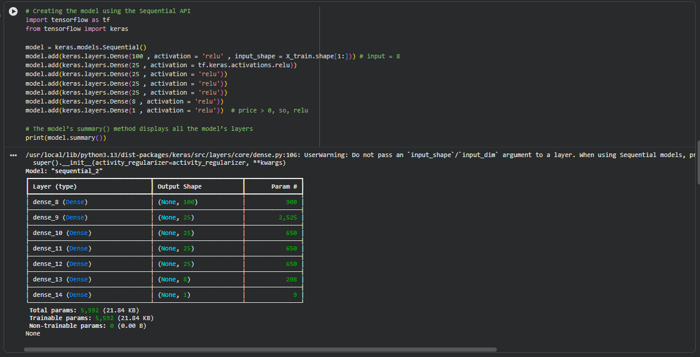
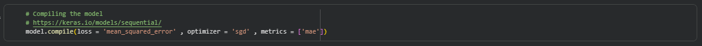
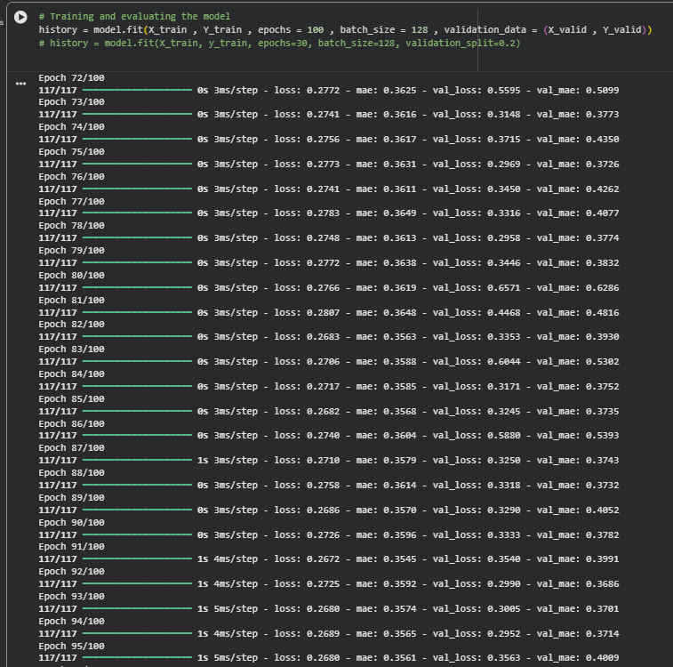
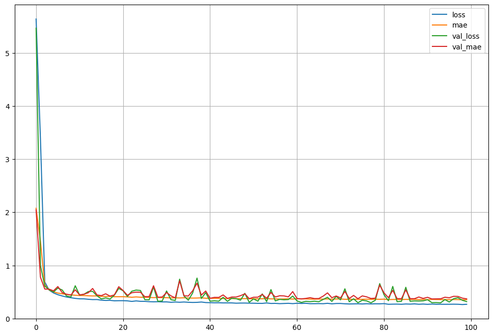
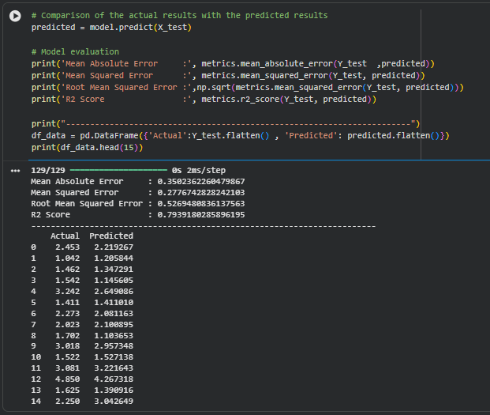

# 🏠 California Housing Price Prediction — Deep Learning (MLP Regression)


## 📌 Project Overview
This project implements a **Deep Multi-Layer Perceptron (MLP)** neural network for regression using **TensorFlow & Keras (Sequential API)** to predict median house values in California districts based on the **California Housing Dataset**.

The workflow covers the complete machine learning pipeline: data exploration, missing/duplicate value checks, feature standardization, train/validation/test splitting, deep neural network construction, training with validation monitoring, and model evaluation.

---

## 📊 Dataset Description
The project uses the standard **California Housing Dataset** (`sklearn.datasets.fetch_california_housing`), which contains **20,640 samples** and **8 numerical features**:

| Feature | Description |
| :--- | :--- |
| **`MedInc`** | Median income in block group |
| **`HouseAge`** | Median house age in block group |
| **`AveRooms`** | Average number of rooms per household |
| **`AveBedrms`** | Average number of bedrooms per household |
| **`Population`** | Block group population |
| **`AveOccup`** | Average number of household members |
| **`Latitude`** | Block group latitude |
| **`Longitude`** | Block group longitude |
| **`price` (Target)** | Median house value for California districts (in $100,000s) |

---

## 🛠️ Workflow & Implementation Steps

### 1. Data Exploration & Preprocessing
- **Duplicate & Missing Values Check:** Verified dataset integrity (`0` duplicate rows and `0` missing values across all columns).
- **Feature Scaling:** Standardized all 8 input features using `StandardScaler` (`mean = 0`, `std = 1`) for stable gradient descent convergence.
- **Dataset Splitting:**
  - **Training Set:** `14,860` samples (`72%`)
  - **Validation Set:** `1,652` samples (`8%`)
  - **Testing Set:** `4,128` samples (`20%`)





---

### 2. Model Architecture (Sequential MLP)
Built a 7-layer Fully Connected Neural Network using the Keras `Sequential` API:

- **Input Shape:** `(8,)`
- **Hidden Layer 1:** `Dense(100, activation='relu')`
- **Hidden Layers 2–5:** `4 × Dense(25, activation='relu')`
- **Hidden Layer 6:** `Dense(8, activation='relu')`
- **Output Layer:** `Dense(1, activation='relu')`
- **Total Trainable Parameters:** `5,592`



---

### 3. Model Compilation & Training
- **Loss Function:** Mean Squared Error (`mean_squared_error`)
- **Optimizer:** Stochastic Gradient Descent (`sgd`)
- **Evaluation Metric:** Mean Absolute Error (`mae`)
- **Training Configuration:** `100` Epochs | `Batch Size = 128`





---

## 📈 Learning Curves & Results

### Training vs. Validation Curves
The model rapidly converges within the first 20 epochs and maintains stable training and validation loss/MAE across 100 epochs:



### Test Set Performance Metrics
| Metric | Score |
| :--- | :--- |
| **Mean Absolute Error (MAE)** | `0.3502` |
| **Mean Squared Error (MSE)** | `0.2777` |
| **Root Mean Squared Error (RMSE)** | `0.5269` |
| **$R^2$ Score** | **`0.7939` (~79.4%)** |



---

## 🚀 How to Run the Project

1. **Clone the repository:**
   ```bash
   git clone https://github.com/mahmoudmamsour46/California-Housing-Regression.git
   cd California-Housing-Regression
   ```

2. **Install dependencies:**
   ```bash
   pip install -r requirements.txt
   ```

3. **Launch Jupyter Notebook:**
   ```bash
   jupyter notebook California_Housing_Regression.ipynb
   ```

---

## 🧰 Technologies Used
- **Python 3**
- **TensorFlow / Keras** — Deep Learning Model Construction & Training
- **Scikit-Learn** — Dataset Loading, `StandardScaler`, `train_test_split`, Regression Metrics
- **Pandas & NumPy** — Data Manipulation & Numerical Operations
- **Matplotlib & Seaborn** — Data Visualization & Learning Curves
